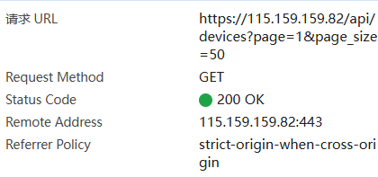
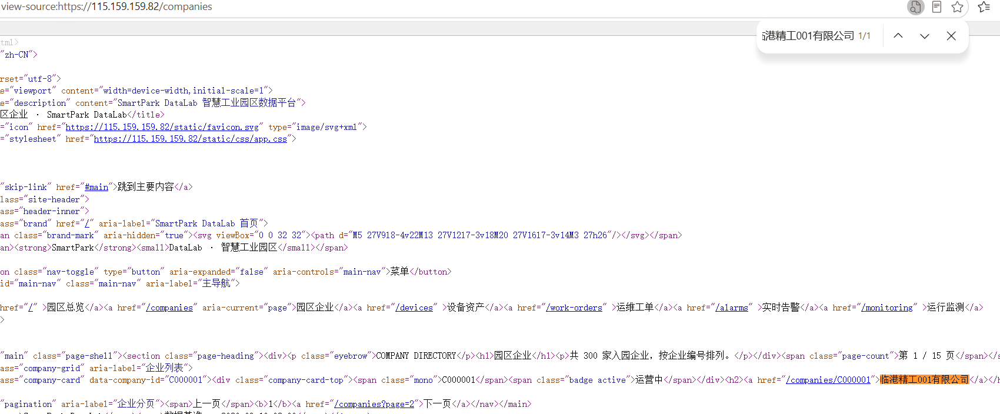
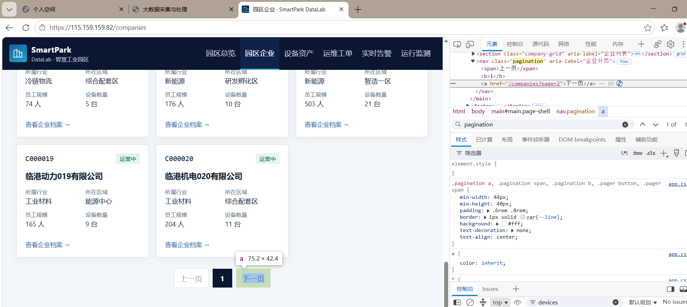
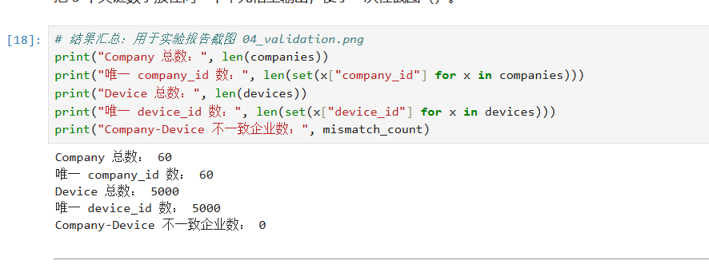

# Lab 1 实验报告

## 学生信息

- **姓名：** 潘政文
- **学号：** 112404260131
- **班级：** 数据1241
- **GitHub 用户名：** （待确认）
- **仓库地址：** https://github.com/用户名/bigdata-collection-labs-112404260131

> 文件位置：`lab01/REPORT.md`  
> 完整代码保存在 `lab1_html_api.ipynb`。  
> 本报告只填写关键发现、关键代码、结果和指定截图，**不要把整份 Notebook 复制进来**。

---

# 任务 1：判断数据加载方式

## 1.1 Device：判断动态加载并找到 API

### 判断结果

- 页面：`/devices`
- 数据加载方式：`动态加载`
- 判断依据：

1. 在"查看网页源代码"中 `Ctrl + F` 搜索页面上真实显示过的设备名称（例如 `循环泵-000001-001`），
   **搜不到**；源码里 `<tbody id="device-rows">` 只有一个"正在加载…"的占位行，
   说明设备记录不是随初始 HTML 一起返回的。
2. 打开 `F12 → Network → Fetch/XHR` 并刷新页面，能找到一条真正返回设备数据的请求：
   `GET /api/devices?page=1&page_size=50`，返回 `application/json`，响应体的 `items` 里就是设备列表。
   该请求由 `/static/js/devices.js` 中的 `fetch('/api/devices?...')` 触发。

### API 信息

- Request URL：`https://115.159.159.82/api/devices?page=1&page_size=50`
- Request Method：`GET`
- Query 参数：`page=1`（当前页码，从 1 开始）、`page_size=50`（每页条数，页面脚本固定为 50）
  - 另有可选筛选参数 `company_id`、`device_type`、`status`、`zone`，本实验不传

### 【截图 1】Device API 发现证据

文件名：

```text
images/01_device_api.png
```

**截图内容必须是浏览器 DevTools，不是 Jupyter 代码。**

截图中应能看清：

1. 浏览器的 **Network** 面板；
2. 已选中真正返回设备列表的 Fetch/XHR 请求（名称为 `devices?page=1&page_size=50`）；
3. 右侧 **Headers** 中的 Request URL；
4. Query String Parameters 中的 `page` 与 `page_size`。

> 不要截整个桌面；尽量裁剪到 Network 请求和右侧 Headers 区域。

插入：

```markdown

```

> 待补拍：该截图必须在你自己浏览器的 DevTools 中完成（Ctrl+Shift+I → Network → Fetch/XHR → 刷新 → 点中 `devices?...` 请求）。

---

## 1.2 Company：判断静态加载

- 页面：`/companies`
- 数据加载方式：`静态加载`
- 判断依据：

使用"右键 → 查看网页源代码"后，`Ctrl + F` 搜索页面中真实显示的企业名称
（例如 `临港精工001有限公司`）**可以直接命中**；源码中还能看到完整的企业记录节点：

```html
<article class="company-card" data-company-id="C000001">
  <div class="company-card-top">
    <span class="mono">C000001</span><span class="badge active">运营中</span>
  </div>
  <h2><a href="/companies/C000001">临港精工001有限公司</a></h2>
  <dl>
    <div><dt>所属行业</dt><dd>汽车零部件</dd></div>
    <div><dt>所在区域</dt><dd>智造一区</dd></div>
    <div><dt>员工规模</dt><dd>88 人</dd></div>
    <div><dt>设备数量</dt><dd>6 台</dd></div>
  </dl>
</article>
```

说明企业数据是随 HTML 一起返回的，可以直接用 `requests` + BeautifulSoup 解析。

### 【截图 2】Company 静态加载证据

文件名：

```text
images/02_company_source.png
```

**截图内容必须是"查看网页源代码"页面，不是 Elements，也不是 Jupyter。**

截图中应能看清：

1. 浏览器正在显示 `/companies` 的网页源代码；
2. 使用 `Ctrl + F` 搜索一个页面中真实存在的企业名称；
3. 源代码中能看到该企业名称或对应企业记录。

插入：

```markdown

```

> 待补拍：右键 → 查看网页源代码 → `Ctrl + F` 搜索 `临港精工001有限公司` 后截图。

---

# 任务 2：Device API 分页采集

## 2.1 API 分页结构

填写你实际从 JSON 中观察到的字段：

| 含义 | JSON 字段 |
|---|---|
| 当前页 | `page` |
| 每页条数 | `page_size` |
| 设备总数 | `total` |
| 设备列表 | `items` |

---

## 2.2 关键代码

只填写分页采集的核心部分，不要粘贴整个 Notebook。

```python
# 从第一页响应中读取分页信息
total = data["total"]
page_size = data["page_size"]

total_pages = (total + page_size - 1) // page_size

devices = []

for page in range(1, total_pages + 1):
    r = requests.get(
        api_url,
        params={
            "page": page,
            "page_size": page_size
        },
        timeout=10
    )
    r.raise_for_status()

    page_data = r.json()
    page_items = page_data["items"]
    devices.extend(page_items)
```

---

## 2.3 采集结果

- 每页条数：50
- 设备总数：5000
- 程序计算得到的总页数：`(5000 + 50 - 1) // 50 = 100`
- 最终采集设备数：5000
- 唯一 `device_id` 数：5000

回答：

> 为什么总页数应由 API 返回的 `total` 和 `page_size` 计算，而不是直接在代码里写死？

答：`total` 和 `page_size` 是数据源在运行时给出的真实值，写死 100 只是"这一次恰好等于 100"。
一旦设备增加/减少，或前端把 `page_size` 从 50 改成 20，写死的页数就会漏采数据或发出多余的空请求；
由接口返回值动态计算总页数，代码才能自动适应数据变化，不需要每次手改。

---

# 任务 3：Company HTML 解析

## 3.1 企业记录 Selector

- 企业记录 selector：`article.company-card`
- 第 1 页企业记录数：20

说明为什么选择这个 selector：

- 主要使用了 `id / class / data-* / 父子层级` 中的哪一种？
  主要用 **class**（`article` 标签名 + `class="company-card"` 做限定）；
  `data-company-id` 用来取 `company_id` 字段，但不用它定位记录。
- 是否参考过浏览器 Copy selector 或 AI？
  参考过浏览器 Copy selector，它给出的是
  `body > main > section.company-grid > article:nth-child(1)`：
  又长，而且只能选中第一条，`nth-child(1)` 一旦插入新节点就会选错。
- 最终为什么采用现在这个写法？
  `company-card` 这个 class 语义明确，一个 class 就与"一条企业记录"一一对应；
  写法最短，不依赖外层容器和兄弟顺序，页面结构调整时不敏感。
  验证方式是 `len(soup.select("article.company-card")) == 20`，与页面显示的企业数一致。

---

## 3.2 关键代码

只填写"记录定位 + 一条记录的关键字段"。

```python
cards = soup.select("article.company-card")

card = cards[0]

company_id = card.get("data-company-id")
name = card.select_one("h2 a").get_text(strip=True)
status = card.select_one(".company-card-top .badge").get_text(strip=True)
```

行业、区域、设备数量使用 `dt/dd` 结构后，请写出你最终如何得到：

```python
details = {}
for item in card.select("dl > div"):
    key = item.select_one("dt").get_text(strip=True)
    value = item.select_one("dd").get_text(strip=True)
    details[key] = value

industry = details["所属行业"]
zone = details["所在区域"]
device_count = int(details["设备数量"].replace("台", "").strip())
```

---

## 3.3 字段来源说明

任选 **2 个字段**说明：

1. 字段：`company_id`
   - 来自：`HTML 属性`
   - 使用的方法：记录节点上的 `data-company-id`，用 `card.get("data-company-id")` 读取；
     用属性而不是解析可见文本，是因为属性值格式稳定（`C000001`），不受显示样式影响。

2. 字段：`device_count`
   - 来自：`文本`
   - 使用的方法：先由 `dt/dd` 转成字典拿到 `"6 台"`，
     再用 `int(value.replace("台", "").strip())` 去掉单位并转成整数，便于后续与 Device 数据比较。

---

# 任务 4：Company "下一页"分页

## 4.1 下一页元素

- "下一页" selector：`nav.pagination a:last-child`
- 第 1 页 `href` 示例：`/companies?page=2`

选择理由：分页节点结构为

```html
<nav class="pagination" aria-label="企业分页">
  <span>上一页</span><b>1</b><a href="/companies?page=2">下一页</a>
</nav>
```

其中**只有一个"上一页"和一个"下一页"**：当前页是 `<b>`，不可点击的一侧是 `<span>`。
因此在 `nav.pagination` 内部，**最后一个 `<a>` 必然是"下一页"**。
用 `a:last-child` 在最后一页会返回 `None`（那一页"下一页"是 `<span>`），
正好可以作为"停止翻页"的判据。`href` 是相对路径，需要用 `urljoin` 拼成绝对地址。

### 【截图 3】Company "下一页"元素

文件名：

```text
images/03_company_next.png
```

**截图内容必须是浏览器 DevTools 的 Elements 面板。**

截图中应能看清：

1. 页面底部"下一页"对应的 `<a>` 元素被选中；
2. 该元素的 `class`（`pagination`）与 `href`（`/companies?page=2`）等关键属性；
3. 能判断你为什么使用当前 selector。

> 不需要截 Python 代码；这一张图只证明你找到了正确的 DOM 元素。

插入：

```markdown

```

> 待补拍：F12 → Elements → `Ctrl+F` 输入 `pagination` 定位到 `<nav class="pagination">` → 点中其中的 `<a href="/companies?page=2">下一页</a>`。

---

## 4.2 关键代码

```python
next_link = soup.select_one("nav.pagination a:last-child")

next_href = next_link.get("href")

next_url = urljoin(
    current_url,
    next_href
)
```

再用 2～3 句话说明：

> 你的程序如何完成"当前页 → 找下一页 href → 请求下一页 → 再解析"的循环？

答：循环里始终维护一个 `current_url` 变量。每一轮先用 `session.get(current_url)` 请求当前页，
再用同一个 `soup` 解析出本页企业并追加到 `companies`；
然后重新在当前页的 `nav.pagination` 里取最后一个 `<a>` 作为"下一页"，
用 `urljoin(current_url, next_link.get("href"))` 把相对地址解析成新的绝对地址并赋给 `current_url`，
下一轮就自动请求它。取不到 `<a>`（最后一页）就 `break`，因此循环条件只写"采 3 页"也不会越界。

---

## 4.3 三页采集结果

| 页码 | 企业数 |
|---|---:|
| 1 | 20 |
| 2 | 20 |
| 3 | 20 |
| **合计** | **60** |

- 唯一 `company_id` 数：60

---

# 任务 5：结果验证

## 5.1 最终结果

| 检查项 | 结果 |
|---|---:|
| Company 总数 | 60 |
| 唯一 `company_id` | 60 |
| Device 总数 | 5000 |
| 唯一 `device_id` | 5000 |
| Company–Device 不一致企业数 | 0 |

### 【截图 4】最终验证结果

文件名：

```text
images/04_validation.png
```

**截图内容必须是 JupyterLab 的运行结果，不是代码截图，也不是浏览器截图。**

截图中应能同时看清以下输出：

```text
Company 总数
唯一 company_id 数
Device 总数
唯一 device_id 数
Company–Device 不一致企业数
```

建议把这几个 `print()` 放在同一个 Notebook 单元格中运行后截图。

插入：

```markdown

```

> 待补拍：在 JupyterLab 中打开 `lab1_html_api.ipynb`，运行到最后两个单元格后截图（输出为 60 / 60 / 5000 / 5000 / 0）。

---

## 5.2 一致性检查关键代码

只填写最关键的比较逻辑：

```python
from collections import Counter

device_counts = Counter(
    x["company_id"] for x in devices
)

mismatch_count = 0

for company in companies:
    cid = company["company_id"]
    expected = company["device_count"]
    actual = device_counts.get(cid, 0)

    if expected != actual:
        mismatch_count += 1
```

回答：

> 为什么 `status_code == 200` 仍然不能说明"数据已经采集正确"？

答：200 只说明"服务器成功返回了响应"，并不保证响应内容就是我们要的那份数据。
实际可能出现：请求打到带筛选条件的接口导致条数变少；分页参数写错，采到的全是第一页而条数看着正常；
字段名改了导致取到 `None`；返回的是提示页/风控页但状态码仍是 200。
所以必须再做内容层面的校验：用 `total` / `page_size` 核对数量，用 `set()` 检查 ID 唯一性，
再用 Company 页面上的 `device_count` 与 Device 数据统计结果交叉比对，
三者都通过才能说明采集正确。

---

# 任务 6：保存采集结果

确认已经生成：

```text
data/companies.json
data/devices.json
```

填写：

- `companies.json`：`已生成`（60 条，约 14 KB）
- `devices.json`：`已生成`（5000 条，约 1.98 MB）

不需要截图 JSON 全文，也不需要把 JSON 内容复制到报告。

---

# 实验结论

用 **80～150 字**总结：

1. 静态加载与动态加载页面的处理方式有什么不同；
2. HTML "下一页"分页和 API `page` 分页有什么不同；
3. 你使用了哪些方法验证采集结果。

答：静态页面的数据随 HTML 一起返回，`requests` + BeautifulSoup 直接解析即可；动态页面的数据由 JS 经 API 异步获取，必须先看 Network 找到接口再请求 JSON，爬 HTML 拿不到。HTML 分页要跟随"下一页"链接逐页请求，改版就得改选择器；API 分页由 `page` / `page_size` 控制，总页数可由 `total` 算出，更稳定。验证用了数量与 ID 唯一性校验，以及 Company–Device 一致性交叉检查。
